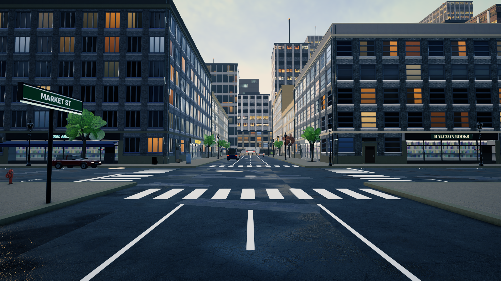
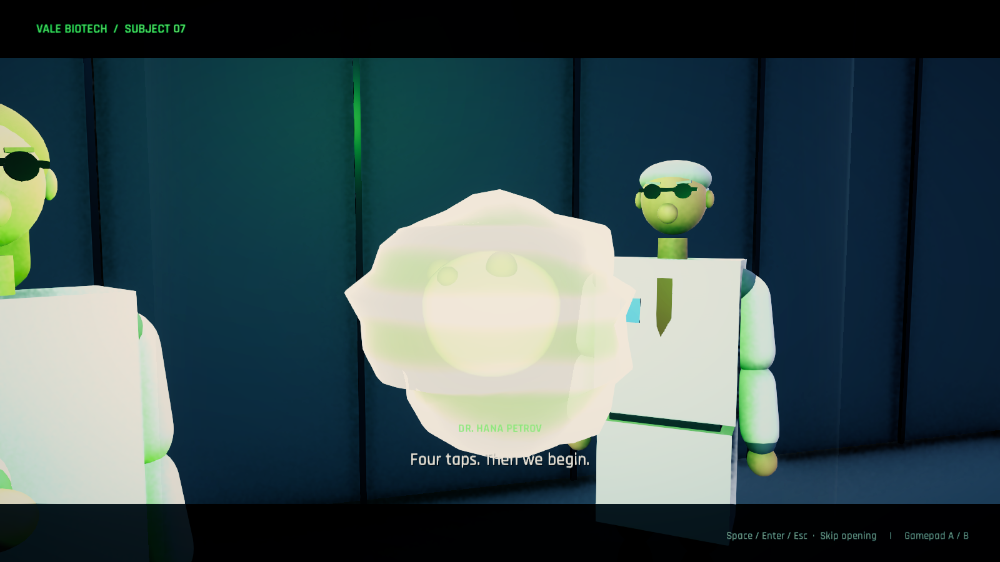
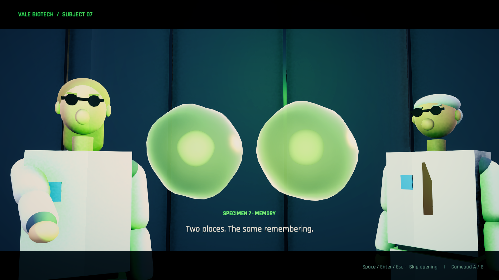
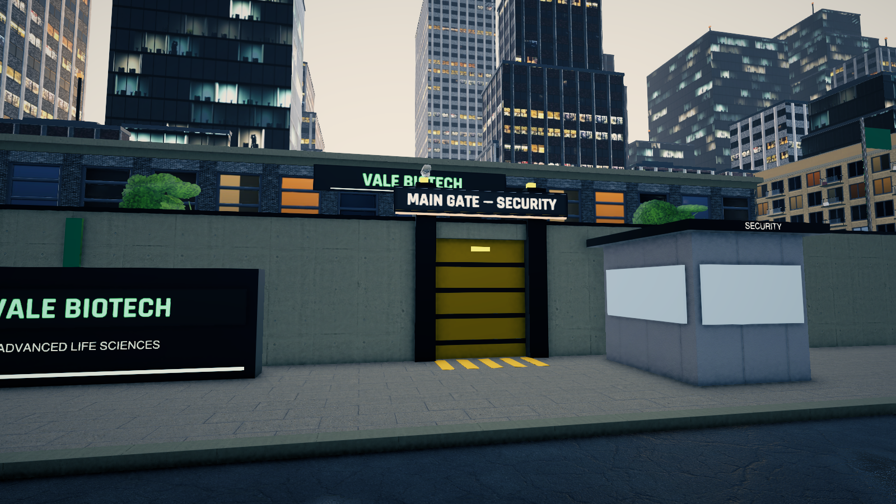
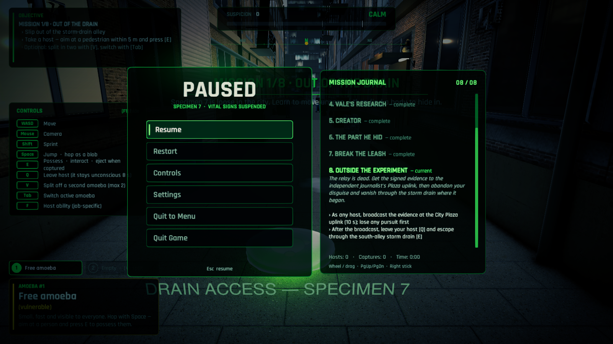
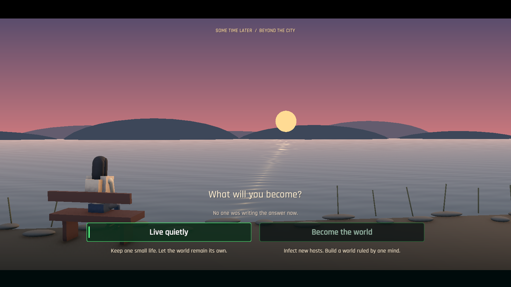
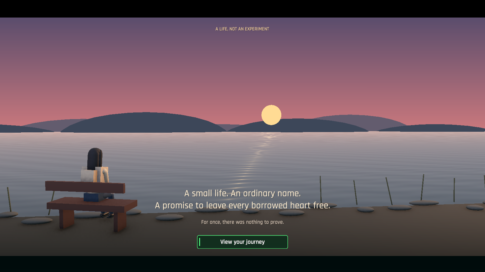
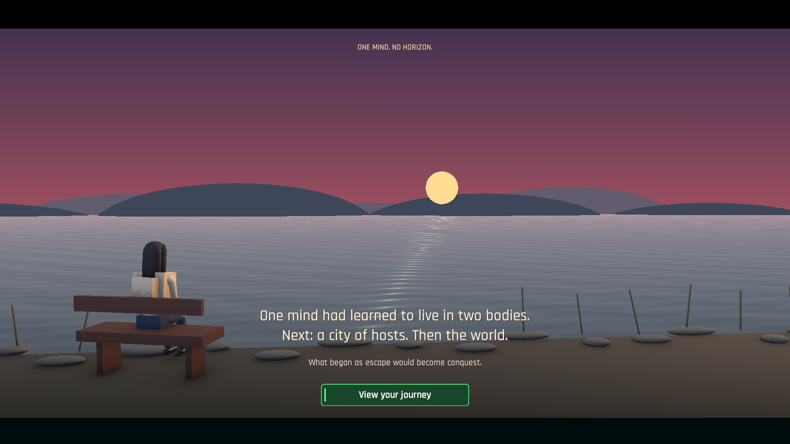

# PARASITE Complete Game Guide

**Version 0.2.0 · Linux x86-64 · Player handbook, judges guide and verification record**

PARASITE is a third-person stealth game about **Specimen 7**, an escaped amoeba that can possess people and divide into two controllable bodies. Your host changes what you can do and where you can go. Your two bodies turn the city into a planning problem: one can hold a control while the other acts somewhere else.

The complete release contains an **80-second skippable opening**, **eight connected missions**, **three infiltration routes**, and a sunset-lake epilogue with **two explicit endings**. Meeting Dr. Vale is the midpoint, not the finish. This guide explains the game, provides a full walkthrough and short presentation flow, and distinguishes verified results from remaining validation limits.

**Spoilers:** the mission and ending sections reveal the whole campaign. For a first playthrough, read Getting started, Controls and Core mechanics, then follow the yellow waypoints.



*The playable district uses a generated street layout, textured buildings, props, lighting and ambient traffic. This is a real Unity environment render, not concept art.*

## Contents

1. [Getting started](#getting-started)
2. [Controls and settings](#controls-and-settings)
3. [Core mechanics and host roles](#core-mechanics-and-host-roles)
4. [The backstory and opening](#the-backstory-and-opening)
5. [All eight missions](#all-eight-missions)
6. [The lakeside choice and endings](#the-lakeside-choice-and-endings)
7. [A short judges presentation](#a-short-judges-presentation)
8. [How the game is built](#how-the-game-is-built)
9. [Testing and evidence](#testing-and-evidence)
10. [Known limits and credits](#known-limits-and-credits)

## Getting started

Extract the **entire Linux archive**. Keep `Parasite.x86_64`, `Parasite_Data` and the Unity libraries together inside the `Linux` folder. From that folder, run:

```bash
./play.sh
```

If executable permissions were lost during transfer:

```bash
chmod +x play.sh Parasite.x86_64
./play.sh
```

On an NVIDIA hybrid laptop, the following selects the discrete GPU when the machine supports PRIME offload:

```bash
__NV_PRIME_RENDER_OFFLOAD=1 __GLX_VENDOR_LIBRARY_NAME=nvidia ./play.sh
```

Choose **Begin Infiltration**. The opening plays before you receive control in the storm-drain alley. To skip, press **Space**, **Enter** or **Esc**, then release the key. Restart and checkpoint reloads go directly to gameplay rather than replaying the opening.

The project-root `./play.sh` is a separate development launcher that starts `Builds/Linux/Parasite.x86_64` with the workstation's GPU/display setup. Neither launcher requires the Unity Editor to play the packaged game.

## Controls and settings

| Keyboard and mouse | Gamepad binding | Action |
|---|---|---|
| WASD or arrow keys | Left stick | Move |
| Mouse | Right stick | Look around |
| Shift | Left stick press | Sprint |
| Space | South button | Hop or jump |
| E | West button | Possess, interact or eject when captured |
| Q | East button | Leave the current host |
| V | North button | Split into a second amoeba |
| Tab | Right shoulder | Switch between your bodies |
| F | Left shoulder | Use your host's profession ability |
| Esc | Start | Pause or return from a pause submenu |
| F1 | — | Show or hide the controls card |
| F3 | — | Show or hide the FPS counter |
| Ctrl + M | — | Presentation shortcut to the final escape and lakeside choices |

Menus accept the mouse or directional navigation with confirm. In the opening, gamepad South/East skips after release. At the lake, select an ending deliberately; waiting, Escape or a dialogue skip never chooses one for you. Gamepad bindings are implemented, but physical controller testing is not claimed.

**Settings**, available from both title and pause menus, save graphics quality, mouse sensitivity, master volume and ambience/music gain. Volume changes apply immediately, including mute. Graphics presets are Low, Medium, High and Ultra; lower presets reduce render scale and shadow distance. Use a lower preset if frame delivery is uneven.

## Core mechanics and host roles

### Possession and release

Aim at an awake person within **5 metres**. When the possession prompt appears, press **E**. The amoeba leaps into that person, and you control the host with the same movement and camera inputs. Host credentials determine access; a civilian cannot simply open a restricted staff entrance.

Press **Q** to leave. The person collapses for approximately **8 seconds**, then recovers and resumes AI behavior. A witness finding an unconscious body raises suspicion, so leaving a host in a busy area has consequences.

### Split and switch

Press **V** to create your second body, then **Tab** to switch. You can control **at most two amoebas**. The inactive body stays where you left it, including inside its host. This is essential for the office readers and the later coolant/dispatch operations. Splitting in front of witnesses is suspicious.

The support consoles are physical commitments: press **E** to arm a console with the required host, keep that body nearby, and switch to the other amoeba. Moving away, abandoning the host or being captured interrupts dependent work. Completed mission flags survive a checkpoint reload; temporary host positions and armed console operators do not.

| Host | Access role | F ability | Cooldown |
|---|---|---|---:|
| Civilian | Blends into public areas | Distracts nearby guards toward the aimed location | 16 s |
| Guard | Main-gate security badge | Sends other nearby guards to investigate an aimed location | 28 s |
| Scientist | Staff terminal credentials | Lowers suspicion by 30, except during pursuit | 30 s |
| Maintenance | Service-tunnel keys | Disables cameras within 25 m for 20 seconds | 35 s |

Cooldowns apply by profession. An unsuccessful action, such as a power cut with no camera nearby, does not become a successful mission interaction. Profession abilities help with stealth; they do not replace the dedicated mission consoles.

### Suspicion and capture

Suspicion rises from **observed** violations: a visible free amoeba, witnessed possession or splitting, discovered bodies, trespassing or an unauthorized access attempt. Human witnesses and CCTV use visibility checks; cover can block a camera's view.

| Meter | State | What it means |
|---:|---|---|
| 0–29 | Calm | Low immediate attention |
| 30–59 | Curious | Activity is drawing attention |
| 60–84 | Investigating | Guards search suspicious locations |
| 85–100 | Pursuit | Guards actively hunt the suspect |

Break line of sight and avoid further observations to let suspicion decay. A scientist's reassurance cannot cancel pursuit. If a guard captures your host, **E** ejects the amoeba and gives a brief escape window. If a free amoeba is contained, control can continue with another surviving body; if none remains, the game reloads the latest checkpoint.

Story sequences freeze the live world, including guards, suspicion and capture timers. You are not expected to dodge a guard while cinematic input is locked.

## The backstory and opening

Vale Biotech originally developed a living tissue-repair culture. Six cultures merely followed a stimulus; the seventh began anticipating it. Dr. Hana Petrov tapped the observation glass four times, pausing before the last tap. Specimen 7 learned the rhythm and began answering before she finished.

Petrov interpreted this as recognition. Dr. Elias Vale interpreted it as conditioning and redirected the project toward controlling a host's movement. The opening establishes the organism's emerging agency, its shared intention across two bodies and the unsettling but survivable contact with a human nervous system.



*A captured frame from the implemented opening, using procedural characters, captions and an in-engine historical set.*

The 80-second sequence moves from the observation vessel through recognition, a split trial, a contact trial, an unexplained interlock release and a service-conduit escape. It finishes at the real storm drain and hands control to the normal third-person camera. The identity behind the released interlock is deliberately withheld until Vale's confrontation.



*The two-lobe shot connects the backstory to the game's two-body limit. Historical actors do not count as gameplay hosts or pre-complete missions.*

This is an **in-engine cinematic**, not a prerecorded video. It uses readable captions and sound effects; there is no recorded voice acting. The separate screenplay document includes an optional memory proposal, which is **not an implemented release feature**.

## All eight missions

Yellow world waypoints and the pause-menu journal explain the current objective. The original three entry routes all reconnect with the same research, post-Vale campaign and final choice.

### 1 Out of the Drain

Move north out of the starting storm-drain alley. Find a pedestrian, aim within 5 metres and press **E** to take your first host. This introduces safe movement, hiding in a human body and the difference between being a visible organism and an ordinary-looking person. Splitting and switching are optional learning objectives here.

### 2 Word on the Street

Read the **City Plaza newsstand**. Then approach **Dr. Hana Petrov at the café** as a host and remain close enough to overhear her conversation. Avoid pursuit while listening. The conversation points you toward Vale Biotech and its different access routes.

### 3 Credentials

Choose one infiltration route. You do not need to complete all three in a normal playthrough.

| Route | Required preparation | Entry |
|---|---|---|
| A Security | Possess a guard | Badge through the Main Gate |
| B Staff | Possess a scientist and take the café keycard | Use the Staff Terminal to unlock the staff door |
| C Service | Possess maintenance and reset Substation 4 in the east alley | Open the Service Tunnel |



*The Main Gate is one of three routes into the lab. Access depends on the host and any required prerequisite, not merely reaching the door.*

### 4 Vale's Research

Inside the lab, download the files from **Lab A** and **Lab B**. Vale's office then requires two different staff operators. Split, place each amoeba in a staff host, and badge the two office readers within **8 seconds**, switching with **Tab**. One amoeba cannot satisfy both readers by running between them.

### 5 Creator

Confront Dr. Vale in his office. He reveals that the escape and the research trail were arranged as an experiment. The files you found were bait; his signed archive contains the actual orders. After the protected dialogue, **gameplay resumes** with three missions remaining.

### 6 The Part He Hid

Take a **maintenance host** to the **service-room coolant bypass** and press **E**. Leave that body at the console. Switch to your other amoeba, acquire a **scientist**, and start copying the **signed archive in Vale's office**.

The copy takes **8 seconds**. Both bodies must keep their roles and positions. If the maintenance body leaves coolant, the archive copy stops; return it to position and start the copy again. A maintenance engineer in the service room makes this cooperation available regardless of your original entrance route.

### 7 Break the Leash

Use a **guard host** to hold the **lobby dispatch override**. Keep that body there while a different amoeba in **maintenance** travels to the **east service-alley containment relay** and overloads it for **7 seconds**.

Success permanently disables CCTV and opens campus exits. This changes the world state: the containment network is offline, and you can leave the lab through its unlocked routes. The result survives checkpoint reloads.

### 8 Outside the Experiment

As **any human host**, reach the **City Plaza journalist uplink** and transmit the signed evidence for **10 seconds**. Pursuit blocks or interrupts the upload, so lose the guards before exposing your contact.

After the broadcast, return to the original south alley, press **Q** to leave your host, and interact with the storm drain as a **free amoeba**. A human body cannot fit through this exit. The escape leads into the lakeside epilogue, where you must make the final choice.



*The scrollable journal can display all eight missions. This is an actual UI test capture with a staged late-campaign journal state, not evidence of a separate manual playthrough.*

## The lakeside choice and endings

After the escape, a girl sits beside a quiet lake at sunset. The scene slows the story down and asks what Specimen 7 will do with the freedom it fought for. Both choices are presented openly.



**Live quietly — Peace.** Specimen 7 chooses a small, ordinary life and restraint toward other people. The resolution promises to leave every borrowed heart free.



**Become the world — Dominion.** Specimen 7 chooses to expand its control: first a city of hosts, then the world. The scene gives this choice a distinct resolution rather than treating both buttons as the same ending.



Waiting never chooses. Skipping earlier dialogue does not select a future, and held confirmation input must be released before the choice activates. Your first explicit choice is locked. After its resolution, **View your journey** opens the summary with your chosen future, original infiltration route, total gameplay time, hosts possessed, peak suspicion and captures. The final escape flag is committed only when the chosen ending resolves.

## A short judges presentation

For a compact demonstration, use the implemented **Ctrl + M** shortcut from gameplay. Either Ctrl key works; **M alone does nothing**. The shortcut advances presentation progress and starts the real final escape sequence. It does not select an ending and is not a substitute for completing or testing the campaign.

| Approximate time | Presenter action | What to explain |
|---|---|---|
| 0:00–0:15 | Begin Infiltration; show a little of the opening | Specimen 7 learns recognition and agency through the four-tap rhythm. |
| 0:15–0:25 | Press Space and release it | The skippable story hands control back to one clean player amoeba. |
| 0:25–0:45 | Move, show E possession if a host is nearby, mention V and Tab | Bodies supply credentials; two bodies support spatial cooperation. |
| 0:45 onward | Press Ctrl + M during gameplay | Jump to the final escape for presentation; skip the escape dialogue with E/Space if needed. |
| Final scene | Show the lake and select an ending deliberately | Peace and Dominion represent different futures; then show the summary. |

These timings are a presentation plan, not a measured speedrun. The opening naturally lasts 80 seconds. Ctrl + M starts three protected escape-dialogue lines; E/Space can advance each after 0.5 seconds. The lake's arrival presentation lasts up to 15 seconds, or E/Space/Esc reveals the choices after 0.6 seconds. Release confirm input, select an ending, then watch its seven-second resolution or advance after 0.8 seconds. Leave enough time to read both choices. To show the other ending, start a fresh game, skip the opening and use Ctrl + M again.

## How the game is built

The project uses **Unity 6000.3.29f1**, **URP**, **Cinemachine**, the **Input System** and **AI Navigation**. City and Bootstrap scenes are generated from code; developers edit builders rather than hand-editing scene YAML.

| Area | Responsibility |
|---|---|
| `World/CityDirector` | Creates managers, bakes the runtime NavMesh, spawns NPCs/player and creates camera, HUD, traffic and ambience. |
| `PossessionManager` and controllers | Manage two amoeba slots, possession, release, split/switch, movement and capture/ejection. |
| `HostCharacter`, `HostBrain`, `GuardAI` | Switch human control between player and navigation AI; investigate, pursue and capture. |
| `SuspicionSystem`, `SecurityCamera` | Apply witnessed violations, visibility checks, decay, alerts and camera power state. |
| `MissionManager` and mission components | Define eight missions, prerequisites, waypoints, cooperative controls, interruptible work and extraction. |
| `OpeningCinematic`, `LakesideEpilogue`, `LakesideSet` | Stage story presentation, freeze/restore live simulation and enforce the explicit ending choice. |
| `HUDController` and settings | Build mission UI, journal, menus, subtitles, saved graphics/audio/input settings and final statistics. |
| Editor builders and tools | Generate geometry, mission placement, materials, screenshots and Linux builds. |

`RunState` preserves completed objectives, route and statistics across checkpoint reloads. Graphics/audio/input preferences use saved settings separately. This is not a claim of a full cross-session campaign save system.

The build workflow uses a fast CPU-only Roslyn compile alongside serialized Unity work on the RTX GPU. Only one Unity process opens the project at a time:

```bash
Tools/compile_check.sh all
Tools/unity.sh buildscenes -executeMethod Parasite.EditorTools.CityBuilder.BuildAllBatch
Tools/unity.sh playmode -runTests -testPlatform PlayMode -testResults Logs/playmode-results.xml
Tools/unity.sh build-linux -executeMethod Parasite.EditorTools.BuildAutomation.BuildLinux
Tools/package_build.sh linux
```

Packaging copies player documentation, verification notes, screenshots and licence texts, excludes Unity debug folders, uses fast compression and replaces the archive atomically. Source paths above describe the repository; the player archive does not include the Unity project.

## Testing and evidence

The current release build comes from **runtime source `3f71476`**, with generated city source **`8e86791`**. The final Linux rebuild succeeded at **425 MB**, **6.56 seconds cached**, **zero errors and zero warnings**. The development machine is Ubuntu 26.04 with an Intel i5-12500H, 16 GB RAM and an NVIDIA RTX 4050 Laptop GPU with 6 GB VRAM.

| Check | Verified result and scope |
|---|---|
| Fast compile | 66 runtime and 11 editor source files pass. |
| Editor campaign | All 13 gameplay scenarios pass, including three full eight-mission routes and both final outcomes. |
| Settings and lakeside UI | 3/3 pass, covering actual canvases, explicit choice, outcome immutability and temporary-scene cleanup. |
| Opening rerun | 2/2 pass; all 11 scheduled shot captures, complete unscaled timeline and real queued keyboard skip inputs. |
| Final opening and Ctrl + M focus | 3/3 pass; both Ctrl keys work, M alone is ignored, and no duplicate or automatic ending choice occurs. |
| Pure rules and audio | Earlier 22/22 EditMode tests pass; the relevant rules/audio sources are unchanged. |
| Environment inspection | 15 RTX scene renders; zero missing scripts. |
| Current standalone Linux campaign | **13/13 pass** on the rebuilt executable, including Peace through the Main Gate/staff routes and Dominion through the service route. |

**The earlier test failure is documented, not hidden.** The initial combined PlayMode run passed five cases and failed one opening capture assertion because its accelerated 20× test clock skipped past the first five-second shot. Runtime code was unchanged for that correction. The test was slowed to 2×, and both affected opening cases passed on rerun. All six original unique cases therefore passed across the combined run and targeted rerun; the initial XML itself was not wholly successful. A later three-case focused run passed after the presentation shortcut and release-shot camera correction.

Gameplay coverage includes movement, aiming and possession, release/recovery, split/switch, denied access, every infiltration route, research terminals, two-person office access, the protected Vale reveal under nearby-guard pursuit, coolant-copy interruption, dispatch/relay cooperation, broadcast pursuit refusal/interruption, checkpoint restoration, drain extraction, both endings, CCTV occlusion/power cut, profession cooldowns, capture/ejection, pause and restart.

UI tests use real canvases and queued keyboard input, restoring devices, input routing and saved preferences afterward. Screenshot figures in this guide were inspected before inclusion. Environment figures are Unity scene renders; story/journal/ending figures are captures of actual runtime UI/staging. They are not evidence of physical controller testing.

The rebuilt standalone title was visually inspected. A synthetic X11 input attempt under Wayland did not reliably deliver its title-menu input, so a standalone physical Ctrl + M demonstration is not claimed. The chord itself passed focused Input System tests with queued left/right Ctrl, while standalone campaign acceptance exercises the real executable and both endings through simulated game inputs.

The earlier five-mission build averaged 180 FPS in one RTX 4050 1080p benchmark, but that is **not a fresh 0.2.0 measurement**. That tour had frame-time hitches and an incomplete return leg. It does not establish constant 60 FPS or performance on other hardware. Read [the verification report](TEST_REPORT.md) for authoritative results and evidence paths.

## Known limits and credits

Characters, including the seated girl, use stylized procedural bodies and animation. Cinematics rely on captions and sound effects rather than recorded voices. Puddles use lightweight reflected lighting rather than full water simulation. Traffic follows simplified kinematic lanes and may pass through cross traffic after waiting to avoid permanent deadlock. Imported prop detail is selected during scene generation, not dynamically for every camera distance.

The automated tests do not replace an extended human playthrough or prove physical gamepad operation. **Linux x86-64 is the sole delivery target**; Windows packaging was cancelled and is not a pending release requirement. These are documented release limits, not hidden future features. See [known issues](KNOWN_ISSUES.md).

External textures, HDRI and model sources include **Poly Haven** and **ambientCG**, generally under **CC0**. Selected **Kenney** interface/impact sounds are CC0; other effects and ambience are synthesized in the project. **Rajdhani** UI fonts use **SIL OFL 1.1**. The archive includes the actual font/audio licence texts. The complete per-asset attribution, author names, source links and Unity-package notes are in [third-party assets](THIRD_PARTY_ASSETS.md).

For quick reference, use [controls](CONTROLS.md), [verification](TEST_REPORT.md), [known issues](KNOWN_ISSUES.md) and [third-party credits](THIRD_PARTY_ASSETS.md). This handbook describes the fixed 0.2.0 release: eight missions, its implemented opening, its lakeside choices and the judges presentation shortcut.
