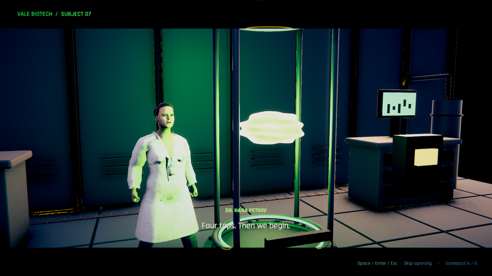
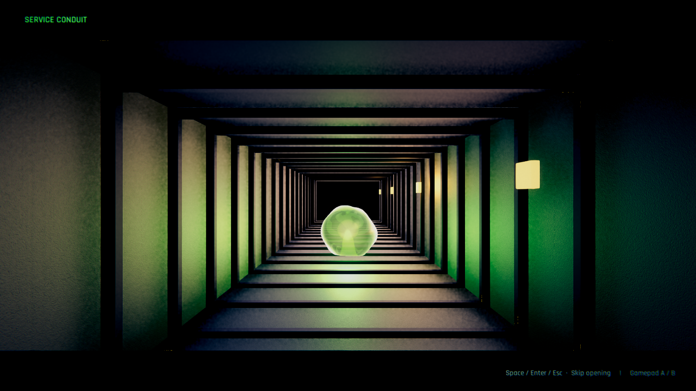
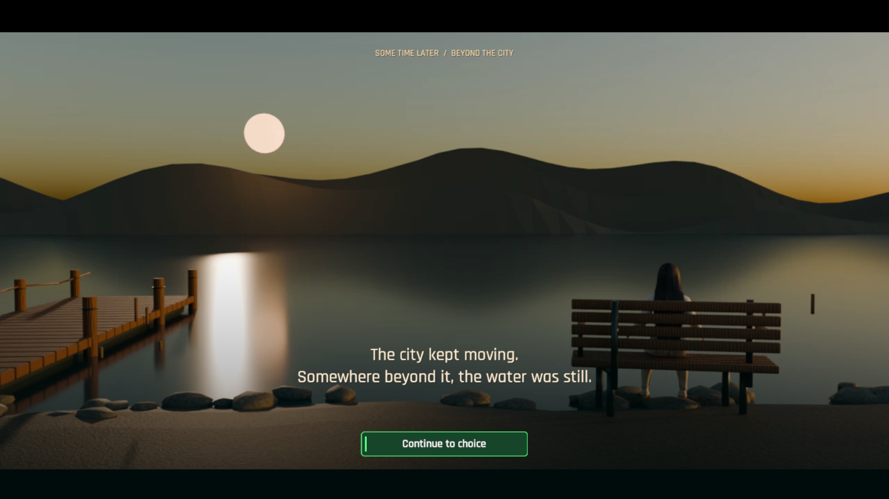

# PARASITE — complete game guide

**0.4.0 upgrade · Linux x86-64 · Fourteen initial missions plus three after the lake**

You are Specimen 7, an escaped amoeba that can possess humans and split into two independent bodies. A borrowed host changes
where you can go and which controls you can use. Many later tasks need one host to hold a console while your other body acts.

The original story ends at the lake with an explicit Peace or Dominion choice. Its summary offers **Continue · After the lake**
to start the riverside chapter. The chosen future persists and changes that chapter's story and radio roles.

**Spoilers below.** For an unspoiled start, read the controls and host roles, then follow the yellow waypoints. This guide
explains current source behavior; the exact built-player validation belongs to [TEST_REPORT.md](TEST_REPORT.md).

## Getting started

From the project root or the extracted Linux build folder, run `./play.sh`. Keep the executable, `Parasite_Data` and the Unity
libraries together. If permissions were lost during transfer, run `chmod +x play.sh Parasite.x86_64` in the extracted folder.
The project launcher selects NVIDIA; extracted builds can use PRIME offload with
`__NV_PRIME_RENDER_OFFLOAD=1 __GLX_VENDOR_LIBRARY_NAME=nvidia ./play.sh`.

Choose **Begin Infiltration**. The eighty-second opening tells the backstory before giving control at the storm drain.
Press Space, Enter or Esc and release to skip; gamepad South/East is also bound. Restart and checkpoint reloads do not replay it.
Settings on the title and pause menus save graphics, sensitivity and audio levels.

## Controls

| Input | Action |
|---|---|
| WASD / mouse | Move / look |
| Shift | Sprint |
| Space | Jump or hop |
| E | Aim at a person to possess, or at a control to interact; captured hosts can eject |
| Q | Leave the current host |
| V | Split, up to two amoebas |
| Tab | Switch active amoeba |
| F | Use the host profession's ability |
| Esc | Pause; close a submenu before resuming |
| F1 / F3 | Controls / FPS |
| Ctrl + M | Presentation jump to the original drain escape and explicit lake choice |

Aim inside five metres for possession. Read the contextual E prompt: it explains profession, permission and prerequisite
requirements. The objective panel and compass show the active mission and controls. Esc also opens the scrollable mission journal.

The presentation shortcut works from initial title, opening, pause, dialogue and gameplay. It never chooses a lake outcome.
It is ignored in the later chapter to preserve its progress. Queued-input tests do not substitute for testing physical controls.

## Host roles and survival

- **Civilian:** blends into public places, but lacks restricted credentials.
- **Guard:** opens security gates, holds dispatch and uses security controls.
- **Scientist:** uses staff terminals, copies research and operates scientific equipment.
- **Maintenance:** powers service routes, disables cameras and operates machinery.

Possessing someone in view, walking as a free amoeba in front of witnesses, or trespassing can raise suspicion. Break sight,
change bodies and move away. A burned host remains known to bio-scanners, so leaving that host matters more than simply waiting.
If a guard captures your body, eject and escape. If no playable amoeba survives, the last checkpoint reloads.

The inactive amoeba stays where you left it. A cooperative console stays held only while its supporting host remains in range.
Use V/Tab to assign the other amoeba and a different host to the paired terminal. Leaving, capture or pursuit can cancel work.
Completed chapter flags survive checkpoint reloads, while transient console ownership must be rearmed. Campaign checkpoints
are in-process state, not an on-disk save.

## Missions 1–6: find the creator

1. **OUT OF THE DRAIN:** leave the alley and take the first host. Learn E/Q possession and V/Tab splitting.
2. **WORD ON THE STREET:** read the plaza newsstand, then listen to Petrov at the café.
3. **THE TAIL:** follow Petrov through Market Street and Avenue North. Stay about 4–20 metres away and stop during her glances.
   Crowding her or losing the trail sends her back to her last leg checkpoint. Take the dead drop when she leaves it.
4. **CREDENTIALS:** choose an infiltration route: a guard opens the main gate; a scientist obtains the café keycard and uses the
   staff terminal; maintenance restores power and uses the service tunnel. You need only one route to continue.
5. **VALE'S RESEARCH:** copy both research terminals, then badge both office readers with separate staff hosts within eight seconds.
6. **CREATOR:** confront Dr. Vale. The reveal is protected dialogue; gameplay resumes when it ends. This is the midpoint.

## Missions 7–10: expose the experiment

7. **HUNTER PROTOCOL:** avoid the hunters' scans. The scanner arch admits a free amoeba rather than a human host. Borrow the
   duty officer to trip the breaker and recall the hunters. A burned body needs to be abandoned.
8. **THE PART HE HID:** keep maintenance at the coolant control while the other amoeba, in a scientist host, copies the signed
   archive for eight seconds. Plan both bodies before starting the download.
9. **BREAK THE LEASH:** a guard holds lobby dispatch while a different maintenance host overloads the east-alley relay for seven
   seconds. The sabotage permanently disables the relevant CCTV and opens exits.
10. **THE SHADOW UPLINK:** reach the plaza uplink and transmit preliminary evidence for ten seconds without pursuit.

## Missions 11–14: the black site and escape

11. **THE BLACK SITE ARCHIVE:** a guard triggers the sub-vault evacuation diversion at lobby security; a scientist breaches Lab A
    and downloads the black-site mainframe for ten seconds.
12. **CONTAINMENT PROTOCOL EPSILON:** maintenance overloads the east-alley auxiliary generator, then guard/scientist overrides the
    forecourt security-grid pylon for eight seconds.
13. **BLACKOUT:** cut all three plaza transformers within one thirty-five-second reroute window. Every switch logs a different
    human palm print. Pre-position your two bodies and arrange a third host for the last switch. Missing the window restores
    the circuits and clears the palm-print log, allowing another attempt.
14. **THE FINAL CONVERGENCE:** transmit the unredacted archive at the plaza master antenna for twelve seconds. Eject with Q and
    return as a free amoeba to the original south-alley storm drain. The escape leads to the sunset lake.

## The lake: an explicit future

The seated girl at the lake represents your new life after the city. Watch the arrival or skip to the choices. Neither a timer
nor a skip input chooses. Release held skip input before the choices become active.

- **Live quietly (Peace):** keep a small life and leave other minds their own.
- **Become the world (Dominion):** begin a wider network under one will.

The first resolved choice is immutable. Its resolution leads to the original campaign statistics. You can stop there, restart,
return to the title, or choose **Continue · After the lake**. Continuing preserves statistics and the chosen future, places you
at a riverside landing as one free amoeba, and appends three missions.

## Missions 15–17: after the still water

15. **AFTER THE STILL WATER:** borrow a host to answer Petrov's emergency receiver, then use maintenance to isolate a contaminated
    floodgate. Peace helps despite a promise of quiet; Dominion seeks a new foothold.
16. **BORROWED HEARTS / A WILLING NETWORK:** a scientist analyses polluted runoff. Split with V, keep a guard holding shelter
    dispatch, and use another scientist host to protect or acquire evacuation records.
17. **THE OPEN CHANNEL / THE FIRST MANY:** maintenance holds mast power while another host transmits. Peace accepts a civilian
    or scientist; Dominion accepts a guard or scientist. Keep pursuit clear, then eject and use the ferry intake as free amoeba.

See the [post-lake walkthrough](AFTERLAKE_GUIDE.md) for precise cooperative-control and checkpoint recovery instructions.

## Graphics and cinematics

Low/Medium/High/Ultra trade resolution, shadows, anti-aliasing, ambient occlusion, local lights and reflection quality. Ultra
uses 125% render scale and 4x MSAA and can be expensive on a 6 GB GPU; benchmark results must name the settings. Try High if frame times
are uneven. F3 shows FPS. Presets should apply consistently to new cinematic cameras as well as the gameplay camera.

The new sets are authored in Blender: containment laboratory, service conduit, slatted bench and detailed shoreline.
The current upgrade also adds RTX/OptiX path-traced Blender film inserts. Real-time Linux gameplay remains URP with screen-space
reflections and probes; this is distinct from hardware ray tracing. See the current test report for actual footage/player-decode
verification, and the handoff for rebuild instructions.

These are real Editor/GPU verification captures. The lake image shows the decoded Blender film; the laboratory and conduit
show the authored game sets. They are not a claim of an extended human playthrough or final-player benchmark.

## Verification and credits

[TEST_REPORT.md](TEST_REPORT.md) names exact tested artifacts, suites and remaining checks. Automated scenarios use simulated
movement/queued input and do not establish a human playthrough or physical gamepad pass. Old screenshots and benchmarks belong
to their original build, not automatically to the current upgrade.

[KNOWN_ISSUES.md](KNOWN_ISSUES.md) records validation limits. [THIRD_PARTY_ASSETS.md](THIRD_PARTY_ASSETS.md) records models, textures,
fonts, animation and audio provenance. [HANDOFF.md](HANDOFF.md) describes source architecture, generated scenes and serialized Unity
commands. [UPGRADE_TRACKER.md](UPGRADE_TRACKER.md) preserves the full active expansion request and completion criteria.
