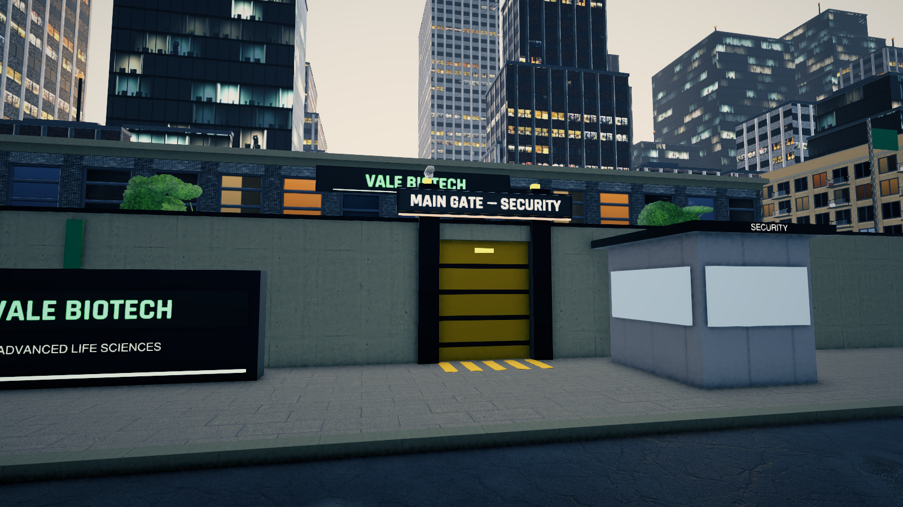

# PARASITE — 0.2.2 (local)

You are Specimen 7: an escaped amoeba looking for the scientist who created it. Possess people, borrow their credentials,
split into two bodies and infiltrate Vale Biotech. Meeting Dr. Vale is the turning point of an **eight-mission campaign**:
steal his signed orders, break containment, expose the experiment and escape.

An **80-second skippable opening** tells the creature's backstory. The finale finds it in a girl's body, seated beside a
lake at sunset. Choose **Live quietly** or **Become the world**. Each future has its own concluding beat and summary;
waiting or skipping never chooses for you.




## Play on Linux

**Linux x86-64 is the release target.** The local player is version **0.2.2**, built from `8ffd786` plus uncommitted Ctrl+M fixes.
Local build and archive files are generated artifacts and are not stored in Git.

- Player: `Builds/Linux/Parasite.x86_64`
- Release archive: `Builds/Releases/PARASITE-Linux.tar.gz` with a `.sha256` checksum

From the project root, run:

```bash
./play.sh
```

The project launcher selects the NVIDIA GPU. For an extracted release, keep the executable, `UnityPlayer.so` and
`Parasite_Data` together, open the extracted `Linux` folder and run its `./play.sh`.

Choose **Begin Infiltration**. Watch the opening, or press **Space**, **Enter** or **Esc**, then release the key to enter
gameplay. Checkpoint reloads and Restart do not replay the opening. Settings in the title and pause menus save graphics,
mouse sensitivity, master volume and ambience/music. The pause journal scrolls through all eight missions.

| Input | Action |
|---|---|
| WASD / mouse | Move / look |
| Shift / Space | Sprint / jump |
| E | Possess, interact, or eject when captured |
| Q | Leave host |
| V / Tab | Split / switch amoebas |
| F | Use the current host's profession ability |
| Esc / F1 / F3 | Pause / controls / FPS |
| Ctrl + M | Jump to the final escape and lakeside choices, including from the initial title |

**Local v0.2.2 presentation fix:** press **Ctrl + M** from the title screen, opening, pause menus, Vale dialogue or gameplay.
Either Ctrl key and either press order work. Loading and body-change requests wait for readiness. The local fix is uncommitted and unpushed; the release checks below describe the earlier committed 0.2.0 baseline.
Local v0.2.2 passed 8/8 focused PlayMode tests (including 11 startup/pause/dialogue/reset phases) and 14/14 queued-keyboard shortcut checks in the built Linux player. Restart the player and confirm v0.2.2 on the title screen.
It bypasses the remaining missions, plays the protected drain escape and reaches the lake. You still explicitly choose
**Live quietly (Peace)** or **Become the world (Dominion)** before the final statistics appear.

Read the [complete game guide](Docs/COMPLETE_GAME_GUIDE.md) for the full walkthrough, paired-body puzzles and screenshots.
The shorter [controls reference](Docs/CONTROLS.md) includes keyboard/gamepad mappings and infiltration routes.

## Verified release checks — historical v0.2.0 baseline

| Check | Result |
|---|---|
| Final Linux build | 425 MB; 6.56-second cached build; zero errors/warnings |
| CPU compilation | 66 runtime and 11 editor source files pass |
| Editor gameplay acceptance | 13/13 scenarios passed, including all three routes and both futures |
| Settings, journal and lakeside UI | 3/3 tests passed; rendered captures inspected |
| Final opening and Ctrl+M checks | 3/3 tests passed, including real queued left/right Ctrl+M input |
| Final standalone Linux acceptance | 13/13 passed on the rebuilt executable: all three eight-mission routes and both futures |

The queued-input tests verify the shortcut inside Unity. A separate visible Linux smoke attempt could not reliably drive
the desktop's synthetic input, so it does **not** establish an interactive standalone Ctrl+M pass. Physical gamepad use
and an extended human playthrough remain unverified. See the [verification report](Docs/TEST_REPORT.md) and
[known issues](Docs/KNOWN_ISSUES.md) for coverage and limits.

## Develop

Read [the handoff](Docs/HANDOFF.md) first. The project uses **Unity 6000.3.29f1**, URP, Cinemachine and the Input System.
Scenes are generated from source; edit the builders instead of scene YAML.

```bash
Tools/compile_check.sh all
Tools/unity.sh buildscenes -executeMethod Parasite.EditorTools.CityBuilder.BuildAllBatch
Tools/unity.sh playmode -runTests -testPlatform PlayMode -testResults Logs/playmode-results.xml
Tools/unity.sh editmode -nographics -runTests -testPlatform EditMode -testResults Logs/editmode-results.xml
Tools/unity.sh build-linux -executeMethod Parasite.EditorTools.BuildAutomation.BuildLinux
Tools/package_build.sh linux
```

The fast compile uses CPU Roslyn; the Unity wrapper serializes editor access and selects the RTX GPU. Logs and rendered
captures live in `Logs/`. Package only after updating the verification report for the built executable.

Run acceptance inside the actual Linux player:

```bash
./play.sh -autotest -autotestOut /tmp/parasite-acceptance.txt
```

External art, audio and fonts: [third-party assets and licences](Docs/THIRD_PARTY_ASSETS.md).
