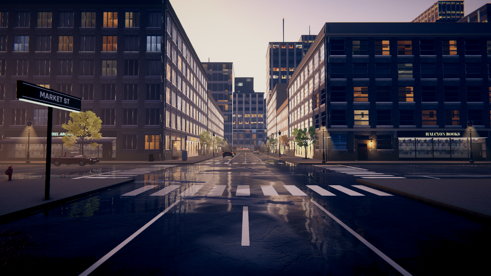

# PARASITE — The Far Shore

You are Specimen 7, an escaped amoeba that borrows human bodies to uncover Vale Biotech's experiments. Use their credentials,
split into two bodies, coordinate different professions and expose the black-site archive.

The twenty-mission baseline is retained in the **0.5.1-preview graphics candidate**. The original fourteen end at a sunset lake, where you explicitly choose
**Peace** or **Dominion**. **Continue · After the lake** opens three riverside missions; **Continue · The Far Shore** then opens
three island missions. Lead protected survivors or direct couriers, carry a physical rescue signal, bring every passenger
aboard and release all borrowed bodies before departure. The first lake choice remains unchanged.

The baseline includes the full **80-second RTX-rendered Blender opening** and four lake films: arrival, a neutral choice hold,
Peace and Dominion. Eight island voice clips, a Blender-authored quarantine-wall kit with 2K PBR maps, centred free-amoeba
camera work, reflection ownership fixes and safe native movie retirement are integrated. Final player verification remains in
progress; [the test report](Docs/TEST_REPORT.md) names the exact tested artifacts and [the tracker](Docs/UPGRADE_TRACKER.md)
preserves the wider active request. A completed render or passing focused test does not establish a final release.



*Earlier Unity environment capture. It is not a screenshot of the final candidate or a human playthrough.*

## Play on Linux

From an extracted build's `Linux` folder, run:

```bash
./play.sh
```

Keep `Parasite.x86_64`, `UnityPlayer.so`, `Parasite_Data` and the other supplied libraries together. The portable launcher
selects NVIDIA offload and prefers Vulkan when NVIDIA is available. To select OpenGL, run
`PARASITE_GRAPHICS_API=glcore ./play.sh`. Explicit Unity graphics API flags take priority.

The launcher in the project root selects the retained `Builds/Linux` preview. That **0.5.0-preview** contains M18 and the four
lake films, not M19/M20 or later fixes. Launch a newer candidate with the `play.sh` beside that candidate's executable.
`BUILD_INFO.json` and [TEST_REPORT.md](Docs/TEST_REPORT.md) identify its source, scope and actual validation. The retained
0.4.2 archive is older and contains two short film inserts. Builds and logs remain local artifacts, outside Git.

Choose **Begin Infiltration** to watch the opening. Press Space, Enter or Esc and release to skip; gamepad South/East is also
bound. Restart and checkpoint reloads do not replay it. At the lake, waiting or skipping never selects a future.

| Input | Action |
|---|---|
| WASD or arrows / mouse | Move / look |
| Left Shift / Space | Sprint / jump |
| E | Possess, interact or eject when captured |
| Q | Leave a host |
| V / Tab | Split / switch amoebas |
| F | Host profession ability |
| Esc / F1 / F3 | Pause / controls / FPS |
| Ctrl + M | Presentation shortcut to the original escape and explicit lake choice |

At a timed control, press E to start and stay close while it works. A paired control needs another amoeba in a different
host. Ctrl+M works from the initial title, opening, pause, dialogue and gameplay, and is ignored after the later chapter starts.
Queued-input tests are separate from physical keyboard/gamepad verification. Campaign checkpoints survive scene reloads in
this process; persistent disk saving is not implemented.

Read [controls](Docs/CONTROLS.md), [the complete twenty-mission guide](Docs/COMPLETE_GAME_GUIDE.md),
[the riverside walkthrough](Docs/AFTERLAKE_GUIDE.md), [known limits](Docs/KNOWN_ISSUES.md) and [the developer handoff](Docs/HANDOFF.md).

## Independent graphics settings

The0.5.1-preview uses shared title/pause pages for **Display**, **Quality**, **Effects** and **Audio & Input**. Stage render
scale, VSync/frame cap, post AA/MSAA, shadows/distance, ambient occlusion, reflections and optional Bloom/grain/color separation;
**Apply** saves graphics, **Cancel** discards the draft, and **Back** discards unapplied graphics while returning one menu level.
Audio and sensitivity apply/save immediately. Custom choices persist separately from the named baseline; existing four profile
budgets are preserved, including High100% and Ultra125%/4xrequestedMSAA. Effects baked into the story movies do not change.

The private build at`Builds/Candidates/full-story-20261125T170047223995Z-63921b41` passes native full-film stress,14queuedshortcuts
and renderedwater22 with zero ring warnings. Native Custom-editing/frame-pacing and full-campaign checks remain separate.
The combined Editor Vulkan warning gate remains open. [Exact candidate scope](Docs/verification/0.5.1-graphics-candidate-20261125.json).
The gate realism pilot is currently source/import work outside this binary; integration and visual/physics/performance checks
remain pending. The previously user-launched0.5.0 candidate remains a separate artifact with its older menu.

## Rendering and Blender

The real-time Linux game uses URP shaders, normal-mapped surfaces, ambient occlusion, shadows, wet ground, foliage, atmosphere,
screen-space reflections and probes. It does not use built-in hardware ray tracing. The user selected Linux gameplay with
**offline RTX/OptiX path-traced Blender cinematics**. Each full film is 1920×1080 at 24 fps, and live game audio supplies its
captions, narration, taps and music.

Editable packed film sets are in `ArtSource/FullCinematics`; [full-opening provenance](ArtSource/FullOpeningFilm/README.md),
[lake-film provenance](ArtSource/FullLakeFilms/README.md) and [wall source/review](ArtSource/Island/QuarantineWalls.README.md)
record the actual assets. Reproducible tools live in `Tools/blender/`. Models, textures, fonts, animations and audio provenance
are recorded in [third-party assets](Docs/THIRD_PARTY_ASSETS.md). Dialogue voices are synthesized.

## Develop and verify

Use Unity **6000.3.29f1** and read the handoff first. Scenes are generated; change their builders, not scene YAML.

```bash
Tools/compile_check.sh all
Tools/unity.sh editmode -nographics -runTests -testPlatform EditMode -testResults Logs/editmode-results.xml
Tools/unity.sh playmode -runTests -testPlatform PlayMode -testResults Logs/playmode-results.xml
```

The Unity wrapper serializes Editor access and selects the RTX. Regenerate scenes through
`Parasite.EditorTools.CityBuilder.BuildAllBatch` after builder/layout changes, then test and rebuild. Keep GPU renders and
Unity graphics/player/benchmark jobs separate.

Build candidates into a fresh path using `Tools/unity.sh <log> -executeMethod Parasite.EditorTools.BuildAutomation.BuildLinux
-parasiteBuildDirectory <fresh-path-inside-Builds>`. Preserve the user's retained preview. Verify all 24 campaign scenarios,
actual full-film story flow, settings and queued shortcuts on the final player; rendered water needs normal graphics mode.
Only package after its test report, source snapshot and hashes agree. The current `Tools/package_build.sh` modifies `Builds/Linux`,
so an explicit-candidate packaging path is required while preserving that preview.
