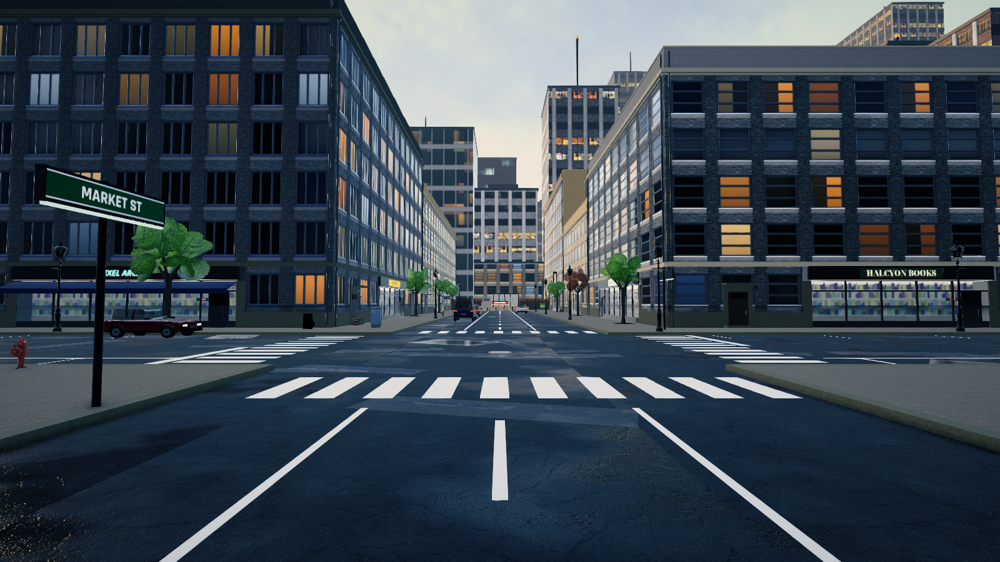

# PARASITE

A third-person stealth game about Specimen 7, an escaped amoeba hunting the scientist who created it.
Possess people, borrow their credentials, split into two bodies, and infiltrate Vale Biotech through a five-mission campaign.




## Play

The demo targets **Linux x86-64 only**. On this development machine, launch it from the project root:

```bash
./play.sh
```

The launcher selects the NVIDIA GPU. Builds are local artifacts under `Builds/` and are not included in Git.
Use **Settings** in the title or pause menu for graphics, mouse sensitivity, master volume and ambience/music.
Preferences survive restarting the game.

| Input | Action |
|---|---|
| WASD / mouse | Move / look |
| Shift / Space | Sprint / jump |
| E | Possess, interact, or eject during capture |
| Q | Leave host |
| V / Tab | Split / switch amoebas |
| F | Use the current host's profession ability |
| Esc / F1 / F3 | Pause / controls / FPS |

Full keyboard and gamepad controls, mission guidance and infiltration routes: [Controls](Docs/CONTROLS.md).

## Develop

Read [the developer handoff](Docs/HANDOFF.md) first. Unity **6000.3.29f1**, URP, Cinemachine and the Input System are used.
City and title scenes are generated from source; edit their builders instead of scene YAML.

```bash
Tools/compile_check.sh all
Tools/unity.sh buildscenes -executeMethod Parasite.EditorTools.CityBuilder.BuildAllBatch
Tools/unity.sh playmode -runTests -testPlatform PlayMode -testResults Logs/playmode-results.xml
Tools/unity.sh editmode -nographics -runTests -testPlatform EditMode -testResults Logs/editmode-results.xml
Tools/unity.sh build-linux -executeMethod Parasite.EditorTools.BuildAutomation.BuildLinux
```

The fast compile uses CPU Roslyn without starting Unity. The Unity wrapper serializes editor access and selects the RTX GPU.
Generated logs and test results live in `Logs/`. Shader compilation uses the Unity cache; avoid clearing `Library/` on the space-limited workstation.

After a successful Linux build, `Tools/package_build.sh linux` creates a player archive
under `Builds/Releases/`, including controls, known issues, verification notes and third-party licences.

Run the actual Linux build's gameplay acceptance suite or an uncapped performance tour:

```bash
./play.sh -autotest -autotestOut /tmp/parasite-acceptance.txt
./play.sh -benchmark -screen-width 1920 -screen-height 1080 -screen-fullscreen 1 -autotestOut /tmp/parasite-benchmark.txt
```

The benchmark reports the active render scale, frame times, memory and reached/timed-out waypoints; NPC AI and traffic stay active.
Judge performance together with route coverage and graphics settings.
Fullscreen avoids the desktop shrinking a 1080p window to fit its title bar; confirm the actual resolution in the report.

External art, audio and font sources: [third-party assets](Docs/THIRD_PARTY_ASSETS.md).
